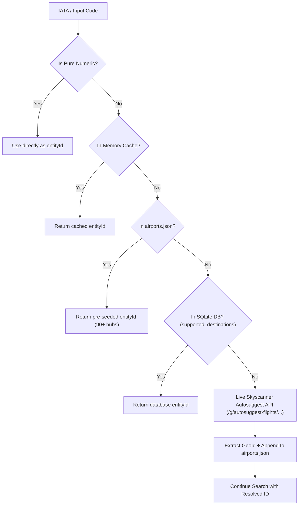

# Pusula CLI — LLM Agent Guide & Skill Reference

`pusula-cli` is a high-performance Skyscanner API wrapper and CLI tool written in Bun and TypeScript. It executes flight searches directly against Skyscanner's internal Radar endpoints (`/g/radar/api/v2/web-unified-search/`) and features automated airport `entityId` resolution and smart cookie handling.

---

## 1. Quick Reference & CLI Invocations

Always invoke the script using the **Bun** runtime.

### A. Flight Search Command
```bash
bun run pusula.ts <ORIGIN> <DESTINATION> <OUTBOUND_DATE> [INBOUND_DATE] [ADULTS] [MAX_STOPS] [FLAGS]
```

#### Positional Arguments:
1. `ORIGIN`: 3-letter IATA code (e.g. `ESB`, `IST`, `LHR`) or numeric Skyscanner `entityId`.
2. `DESTINATION`: 3-letter IATA code (e.g. `BCN`, `AMS`, `AYT`) or numeric `entityId`.
3. `OUTBOUND_DATE`: Date in `YYYY-MM-DD` format (e.g. `2026-11-20`).
4. `INBOUND_DATE`: Optional return date in `YYYY-MM-DD`. Use `-` for one-way flights.
5. `ADULTS`: Integer (default: `1`).
6. `MAX_STOPS`: Max stops allowed: `0` (direct flights only), `1` (up to 1 stop), or `99` (all). Default: `0`.

#### Optional Flags:
* `--cookie <path>`: Explicit path to a cookie file.
* `--cookies <string>`: Inline cookie string (Netscape, JSON, or `key=value;` header).

#### Examples:
```bash
# 1. One-way direct flight from Ankara to Barcelona
bun run pusula.ts ESB BCN 2026-11-20 - 1 0

# 2. Round-trip flight with max 1 stop
bun run pusula.ts SAW VIE 2026-12-05 2026-12-12 1 1

# 3. Using an explicit cookie file
bun run pusula.ts ADB FRA 2026-11-25 - 1 0 --cookie /path/to/cookies.txt
```

---

### B. Airport Entity ID Lookup Command
To look up or pre-seed any IATA code's Skyscanner `entityId`:
```bash
bun run pusula.ts --lookup <IATA>
```
Example:
```bash
bun run pusula.ts --lookup TZX
```
**JSON Output (stdout):**
```json
{
  "code": "TZX",
  "entityId": "128667446",
  "details": {
    "entityId": "128667446",
    "name": "Trabzon",
    "city": "Trabzon",
    "country": "Türkiye"
  }
}
```

---

## 2. Stdout vs Stderr Protocol (Crucial for Agents)

When executing `pusula.ts` as a subprocess or CLI tool:
* **`stderr`**: Contains all human-readable logs, cookie health warnings, and search progress. **Do not parse stderr for JSON.**
* **`stdout`**: Contains **strictly valid JSON**.
  * On success: Returns `SearchResults` JSON.
  * On failure: Returns `{"totalResults": 0, "flights": [], "error": "..."}`.

### Parsing Example in Python:
```python
import subprocess
import json

res = subprocess.run(
    ["bun", "run", "pusula.ts", "ESB", "BCN", "2026-11-20", "-", "1", "0"],
    capture_output=True,
    text=True,
    cwd="/path/to/pusula-cli"
)

# Parse ONLY stdout
flight_data = json.loads(res.stdout)
print(f"Total flights found: {flight_data.get('totalResults', 0)}")
```

---

## 3. Skyscanner Entity ID Architecture

Skyscanner's search engine does not route searches by raw IATA codes alone; it requires internal numeric identifiers called **`entityId`** (e.g. `ESB` = `128668440`, `BCN` = `95565085`).

`pusula-cli` resolves `entityId` through a 5-step hierarchical fallback:



### Key Agent Takeaways:
* **No Manual Research Needed:** If you query a flight with a previously unknown airport (e.g. `KYA` - Konya), `pusula-cli` will dynamically query Skyscanner's live Autosuggest API, resolve `GeoId: 128668546`, save it into `airports.json`, and proceed with the flight search without throwing an error.
* **Pre-seeded Hubs:** `airports.json` already contains 90+ airports covering Turkey, major European hubs, North America, Central Asia, and the Middle East.

---

## 4. Smart Cookie & User-Agent Management

Skyscanner uses PerimeterX (HUMAN Security) and Cloudflare anti-bot systems. `pusula-cli` requires session cookies to authorize requests.

### A. Hierarchical Cookie Resolution
Agents do not need to hardcode file paths. The client resolves cookies in the following order:
1. `options.cookies` (passed in code as object or string).
2. Environment variables: `PUSULA_COOKIES` or `SKYSCANNER_COOKIES`.
3. `options.cookieFile` or `PUSULA_COOKIE_FILE` environment variable.
4. Auto-discovery relative to script directory: `import.meta.dir/cookies.txt`.
5. Global config directory: `~/.pusula/cookies.txt`.

### B. Supported Formats
* **Netscape format:** Tab-separated lines (`domain`, `flag`, `path`, `secure`, `expiry`, `name`, `value`).
* **JSON format:** Array of cookie objects (`[{"name": "...", "value": "..."}]`) or key-value map.
* **HTTP Header format:** Standard header string (`name1=value1; name2=value2`).

### C. Cookie Health & 403 Forbidden
If Skyscanner returns `HTTP 403: Forbidden` or `COOKIE SÜRESİ DOLDU`:
1. The session tokens (`_px3`, `pxcts`, or `__Secure-session_id`) have expired.
2. In parent architectures (like FlyTracker), trigger the Camoufox cookie renewal service (`POST /refresh-cookies`) to generate a fresh `cookies.txt` and `user-agent.txt`.
3. Retry the search.

---

## 5. Programmatic TypeScript / Node Integration

You can import and use `SkyscannerAPI` directly in TypeScript/JavaScript projects:

```typescript
import { SkyscannerAPI } from 'pusula-cli';

// Initialize with custom options or rely on environment variables
const api = new SkyscannerAPI({
  market: 'TR',
  currency: 'TRY',
  locale: 'tr-TR',
  directOnly: true,
  // Optional: pass cookies directly in-memory
  cookies: process.env.PUSULA_COOKIES
});

// 1. Resolve an airport's metadata
const airport = await api.resolveAirport('AYT');
console.log(`Airport: ${airport?.name}, EntityId: ${airport?.entityId}`);

// 2. Search flights
const results = await api.searchFlights({
  origin: 'ESB',
  destination: 'AYT',
  outboundDate: '2026-11-20',
  adults: 1,
  maxStops: 0,
});

for (const flight of results.flights) {
  console.log(`${flight.price.formatted} - Legs: ${flight.legs.length}`);
}
```

---

## 6. Output Schema Reference

### `SearchResults`
```typescript
interface SearchResults {
  totalResults: number;
  status?: 'complete' | 'incomplete';
  flights: Flight[];
  error?: string;
}

interface Flight {
  id: string;
  price: {
    amount: number;       // Numeric (e.g. 1381.5)
    formatted: string;    // Formatted string (e.g. "1.382 TL")
    currency: string;     // Currency code (e.g. "TRY")
  };
  legs: {
    origin: string;       // Origin IATA code (e.g. "ESB")
    destination: string;  // Destination IATA code (e.g. "AYT")
    departure: string;    // ISO timestamp (e.g. "2026-11-20T12:55:00")
    arrival: string;      // ISO timestamp (e.g. "2026-11-20T14:10:00")
    duration: number;     // Minutes (e.g. 75)
    stops: number;        // Direct = 0, 1 Stop = 1
    segments: {
      origin: string;
      destination: string;
      departure: string;
      arrival: string;
      carrier: string;       // e.g. "AJet", "Pegasus Airlines", "THY"
      carrierCode: string;   // e.g. "TK", "PC", "VF"
      flightNumber: string;  // e.g. "4004"
      duration: number;
    }[];
  }[];
  deeplink: string | null;
}
```
